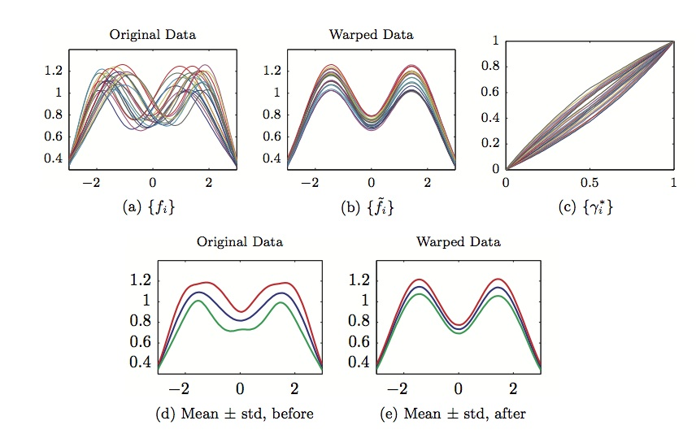

My research centers on functional data analysis, with a focus on geometric (elastic) methods for data that are curves, surfaces, shapes, and images. Much of this work is motivated by applied problems in national security and science, where signals collected from sensors are often misaligned and must be registered before they can be compared, modeled, or used for prediction. Alongside this, I work on Bayesian model calibration and uncertainty quantification for computer simulations, changepoint and anomaly detection for functional data, spatio-temporal point processes, and statistical learning, with applications ranging from materials science and climate to remote sensing and biomedical data.

Within functional data analysis, my current focus is on the registration and statistical analysis of functions in $\mathbb{R}^n$ and images. Specifically, looking at uncertainty quantification and regression modeling of this type of data. Small changes in the sensor placement introduce compositional noise in this type of data. The traditional alignment techniques are based on energy functions that are not proper distances, and necessitate a separate (and thus suboptimal) choice of distance to compare the aligned functions. I work on methods that present a comprehensive technique, for removing compositional noise and aligning functions, that: (1) uses a single cost function for data alignment, (2) combines the data and smoothness in a natural fashion, and (3) leads to a proper distance between aligned functions. It is based on establishing re-parameterization orbits of functions under the warping group and defining a distance between orbits using the Fisher-Rao metric. Using this metric we can compute a proper covariance and perform functional principal component analysis. From the principal components we can develop models of the y variability (aligned data) and x variability (warping functions) and perform classification. I have investigated the use of this framework in modeling and classification of spectral signatures in acoustic data, image registration and classification, and tolerance bound generation.

{fig-align="center" width="80%" fig-alt="Examples of elastic alignment of functional data"}

## Related links

- [FDA Datasets](https://github.com/jdtuck/fda_datasets)
